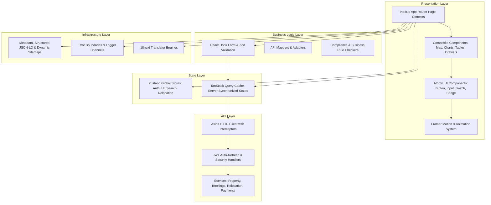
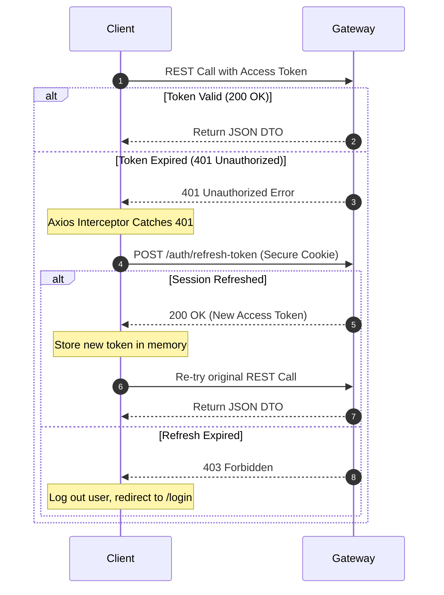

# Rentora AI Frontend Master Blueprint & Technical Implementation Plan (Phase 1)

Rentora AI is an AI-powered housing, relocation, settlement, and community ecosystem for international students, domestic students, professionals, immigrants, families, landlords, builders, universities, and service providers. 

This document serves as the **Phase 1 Master Blueprint & Technical Implementation Plan**, meticulously compiled from the *Frontend Master Specification*, *Design System Bible*, *Screen Flow Bible*, and *Frontend Architecture & Engineering Bible*.

---

## 1. Application Architecture Map

The Rentora AI frontend architecture is built on a highly modular, decoupled, and layered model that guarantees scalability, speed, and safety. 



### 1.1 Presentation Layer
- **Core Technology**: Next.js 14+ (App Router) + TypeScript + SCSS Modules.
- **Micro-Animations**: Framer Motion for high-fidelity, premium interactive states (hover, focus, page transitions, custom springs).
- **Core Principle**: Separation of presentation from state. Every UI component is purely responsive and accessible (WCAG 2.1 AA compliant), supporting dark/light mode dynamically.

### 1.2 Business Logic Layer
- **Form Management**: React Hook Form for high performance, zero-re-render forms.
- **Data Validation**: Zod for client-side schemas, providing compile-time safety and runtime validation of forms and API data.
- **Compliance Rules**: In-app rule checkers to handle regional logic, role restrictions, and platform policies.

### 1.3 State Layer
- **Client-Side State**: Zustand for fast, lightweight global state (sidebar toggle, current user session state, active modals, interactive map states).
- **Server State**: TanStack Query (React Query) for data fetching, automatic caching, re-fetching, optimistic updates, and offline sync.

### 1.4 API Layer
- **HTTP Client**: Axios instance configured with base URL, timeout parameters, and automatic correlation IDs.
- **Interceptor Chains**: Automatic JWT handling. Attaches access tokens to outbound requests and catches `401 Unauthorized` responses to seamlessly refresh the session using a secure HTTP-Only refresh token.
- **Adapter Mappers**: DTO structures mapping raw backend structures into UI-optimized visual objects.

### 1.5 Infrastructure Layer
- **SEO & Discoverability**: Metadata generators, dynamic JSON-LD schemas for properties and local pages, and server-side sitemap engines.
- **Error Governance**: Layered React Error Boundaries, toast logger hooks, and integration-ready console recorders.
- **Localization**: Next-intl routing for native multilingual experience (English, French, etc.).

---

## 2. Next.js App Router Route Map

We use Next.js Route Groups to isolate layouts, security rules, and bundles cleanly.

### 2.1 Route Groups Definition
- `(public)`: Publicly accessible marketing pages, blog, help center, and localized landing pages.
- `(auth)`: Login, registration, password reset, and multi-factor authentication.
- `(onboarding)`: Progressive wizard flow for user-type selection, profiling, verifications, and onboarding steps.
- `(main)`: Interactive property discovery, maps, and property detail screens.
- `(dashboard)`: Core application workspace for authenticated users, providers, and dashboard sub-pages.
- `(admin)`: Site-wide administrative settings, support channels, and dispute resolution dashboards.
- `(super-admin)`: Platform parameters, global fees, tenant approvals, and audit logs.

### 2.2 Complete Path Matrix

| Path | Layout Group | Description | Allowed Roles | State & Fetch Hooks |
| :--- | :--- | :--- | :--- | :--- |
| `/` | `(public)` | Hero page, showcasing solutions, CTA | Anonymous | None |
| `/about` | `(public)` | Company history, team details, roadmap | Anonymous | None |
| `/features` | `(public)` | Ecosystem details, relocation features | Anonymous | None |
| `/pricing` | `(public)` | Pricing plans comparison, dynamic FAQ | Anonymous | `usePricingPlans()` |
| `/contact` | `(public)` | Lead forms and office directory | Anonymous | None |
| `/blog` | `(public)` | Marketing content index | Anonymous | `useBlogPosts()` |
| `/blog/[slug]` | `(public)` | Detailed article layout with recommendations| Anonymous | `useBlogPost(slug)` |
| `/help` | `(public)` | Knowledge base core and ticketing portal | Anonymous | `useHelpCategories()` |
| `/cities/[city]` | `(public)` | Targeted local landing pages for SEO | Anonymous | `useCityProperties()` |
| `/universities/[univ]`| `(public)` | Targeted university partner listing pages | Anonymous | `useUnivProperties()` |
| `/login` | `(auth)` | Secure password/OAuth auth screen | Anonymous | `useLogin()` |
| `/register` | `(auth)` | Register, selecting user category | Anonymous | `useRegister()` |
| `/reset-password` | `(auth)` | Recover account by email/OTP verification | Anonymous | `useResetPassword()` |
| `/verify-otp` | `(auth)` | Mobile/Email verification screen | Anonymous | `useVerifyOtp()` |
| `/mfa` | `(auth)` | Authenticator app security challenge | Anonymous | `useMfaChallenge()` |
| `/onboarding` | `(onboarding)`| Profile builder, preferences, ID check | Guest/Authed | `useOnboarding()` |
| `/search` | `(main)` | Discovery dashboard, Mapbox + grid panels | Guest/Authed | `useSearchProperties()` |
| `/properties/[id]` | `(main)` | Glass-themed property details, 3D tour | Guest/Authed | `usePropertyDetails(id)` |
| `/booking/[id]` | `(main)` | Progressive booking checkout, deposit | Tenant | `useBookingWorkflow(id)` |
| `/dashboard/user` | `(dashboard)` | Overview, alerts, chat & relocation summary| Tenant/Pro | `useUserSummary()` |
| `/dashboard/user/bookings` | `(dashboard)` | Manage leases, sign documents, rent pay | Tenant | `useBookingsList()` |
| `/dashboard/user/payments`| `(dashboard)` | Transaction list, card setup, dynamic receipts| Tenant | `usePaymentsList()` |
| `/dashboard/user/relocation`| `(dashboard)`| Visa helper, task checks, settlement checklist| Tenant | `useRelocationState()` |
| `/dashboard/user/community`| `(dashboard)`| Events listing, local forums, roommate find | Tenant | `useCommunityPosts()` |
| `/dashboard/user/chat` | `(dashboard)` | Document vaults and secure chat channels | Tenant/Pro | `useChatHistory()` |
| `/dashboard/user/profile` | `(dashboard)` | Settings, verifications, secure profiles | Tenant/Pro | `useUserProfile()` |
| `/dashboard/provider` | `(dashboard)` | Landlord analytics dashboard, visual widgets| Provider | `useProviderSummary()` |
| `/dashboard/provider/properties`| `(dashboard)`| Manage listings, create property forms | Provider | `useProviderProperties()` |
| `/dashboard/provider/bookings`| `(dashboard)`| Tenant requests, calendars, payouts | Provider | `useProviderBookings()` |
| `/dashboard/provider/finance`| `(dashboard)`| Rent collections, billing settings | Provider | `useProviderFinance()` |
| `/dashboard/provider/inquiries`| `(dashboard)`| Lead manager, chat, screening outcomes | Provider | `useProviderInquiries()` |
| `/admin` | `(admin)` | Administration overview | Staff Admin | `useAdminMetrics()` |
| `/admin/users` | `(admin)` | Management grid for profiles and access roles | Staff Admin | `useAdminUsers()` |
| `/admin/properties` | `(admin)` | Moderation queue and verification center | Staff Admin | `useAdminProperties()` |
| `/admin/disputes` | `(admin)` | Communication logs and arbitration tools | Staff Admin | `useAdminDisputes()` |
| `/admin/support` | `(admin)` | Service ticket workflow and dashboard queues | Staff Admin | `useAdminTickets()` |
| `/super-admin` | `(super-admin)`| Global platform controls | Super Admin | `useSuperMetrics()` |
| `/super-admin/tenants`| `(super-admin)`| Config for multi-tenant and local tax levels| Super Admin | `useSuperTenants()` |
| `/super-admin/providers`| `(super-admin)`| Enterprise verification queue | Super Admin | `useSuperProviders()` |
| `/super-admin/fees` | `(super-admin)`| Global transaction fee schedules | Super Admin | `useSuperFees()` |
| `/super-admin/api` | `(super-admin)`| System API keys and webhook logs | Super Admin | `useSuperApiKeys()` |
| `/super-admin/audit`| `(super-admin)`| System-wide compliance and activity trails | Super Admin | `useSuperAudits()` |

---

## 3. Standardized Folder Structure

We organize folders based on **Feature-Driven Architecture**, ensuring features are self-contained and modular.

```text
src/
├── app/                              # Next.js App Router (Routing Layouts & Contexts)
│   ├── layout.tsx                    # Global HTML and root configuration
│   ├── page.tsx                      # Landing index page
│   ├── providers.tsx                 # Providers: Zustand, QueryClient, Theme, Motion
│   ├── (public)/                     # Public route pages
│   │   ├── about/page.tsx
│   │   ├── features/page.tsx
│   │   ├── pricing/page.tsx
│   │   ├── contact/page.tsx
│   │   ├── blog/
│   │   │   ├── page.tsx
│   │   │   └── [slug]/page.tsx
│   │   └── help/page.tsx
│   ├── (auth)/                       # Auth pages
│   │   ├── login/page.tsx
│   │   ├── register/page.tsx
│   │   └── reset-password/page.tsx
│   ├── (onboarding)/                 # Onboarding sequence pages
│   │   └── onboarding/page.tsx
│   ├── (main)/                       # Discovery & Property pages
│   │   ├── search/page.tsx
│   │   ├── properties/[id]/page.tsx
│   │   └── booking/[id]/page.tsx
│   └── (dashboard)/                  # User/Provider Dashboard pages
│       ├── layout.tsx                # Shared dashboard layouts (sidebar + topnav)
│       ├── user/
│       │   ├── page.tsx
│       │   ├── bookings/page.tsx
│       │   ├── payments/page.tsx
│       │   ├── relocation/page.tsx
│       │   ├── community/page.tsx
│       │   ├── chat/page.tsx
│       │   └── profile/page.tsx
│       └── provider/
│           ├── page.tsx
│           ├── properties/page.tsx
│           ├── bookings/page.tsx
│           ├── finance/page.tsx
│           └── inquiries/page.tsx
├── components/                       # Shared UI and Layout Elements
│   ├── ui/                           # Pure atomic elements (SCSS module themed)
│   │   ├── button/                   # Button component file
│   │   ├── input/                    # Text input, Search inputs, Validation UI
│   │   ├── select/                   # Searchable & Multi-Select lists
│   │   ├── switch/                   # Preference selectors
│   │   ├── badge/                    # Badge state pills
│   │   ├── tag/                      # Category and interactive tags
│   │   ├── avatar/                   # Profile avatar frame
│   │   └── textarea/                 # Textareas, Rich editors
│   ├── advanced/                     # Complex composite modules
│   │   ├── card/                     # PropertyCard, MetricCard, GlassCard
│   │   ├── map/                      # Mapbox custom overlay markers
│   │   ├── charts/                   # Recharts wrapper for analytics panels
│   │   ├── table/                    # Virtualized data grids
│   │   ├── drawer/                   # Contextual and slide drawers
│   │   ├── modal/                    # Framer Motion portal modals
│   │   └── chat/                     # Message lists and AI assistant frames
│   └── layout/                       # Global core layout sections
│       ├── header/                   # Public landing nav header
│       ├── footer/                   # Public page dynamic footers
│       ├── sidebar/                  # Dashboard multi-level sidebars
│       └── glass-panel/              # Luxury glass panel containers
├── features/                         # Feature Modules (Decoupled State + Logic)
│   ├── auth/                         # JWT, Session validation, Register UI controllers
│   ├── search/                       # Filters state, Search logic, Map handlers
│   ├── properties/                   # Detail page modules, Reviews, Gallery logic
│   ├── booking/                      # Agreement forms, ID verification steps
│   ├── relocation/                   # Progress trackers, settlement lists
│   ├── community/                    # Form panels, event coordinators
│   └── dashboard/                    # Provider analytics feeds, finance grids
├── services/                         # API Data Integrations
│   ├── api-client.ts                 # Base Axios instance with JWT handlers
│   ├── auth.ts                       # Token/Session service endpoints
│   ├── properties.ts                 # Listings search APIs
│   ├── bookings.ts                   # Agreements and invoice endpoints
│   ├── relocation.ts                 # Settlement checklists APIs
│   └── community.ts                  # Forum postings and marketplace data
├── store/                            # Global Client State Stores (Zustand)
│   ├── use-auth-store.ts             # Auth tokens, credentials, profile metadata
│   ├── use-ui-store.ts               # Theme, sidebar state, overlay triggers
│   └── use-search-store.ts           # Map coordinates, spatial filters, tags
├── styles/                           # Styling Core Architecture
│   ├── _variables.scss               # Hex tokens, scales, layouts
│   ├── _mixins.scss                  # Blur layers, breakpoints, glass textures
│   └── global.scss                   # Global browser overrides and presets
├── types/                            # Core TypeScript Interfaces
│   ├── index.ts                      # Common base export
│   ├── api.d.ts                      # API request/response structures
│   ├── models.d.ts                   # Domain entities (Property, Booking, User)
│   └── store.d.ts                    # Zustand states templates
└── utils/                            # Generic Helper Functions
    ├── formatters.ts                 # Date/Currency format libraries
    ├── validations.ts                # Regex helper formats
    └── geolocation.ts                # Map distance calculators
```

---

## 4. Comprehensive Component Inventory

To prevent duplication and guarantee visual excellence, the application is divided into a robust UI system:

### 4.1 Core UI Components (`src/components/ui/`)
1. **Button System**: `Primary`, `Secondary`, `Ghost`, `Icon`, `Floating Action`, with integrated loading spanners and micro-spring responses on tap.
2. **Input System**: `Text`, `Password` (with visibility toggle), `Search` (with clearing button), `Number` inputs.
3. **Textarea System**: `Standard`, `Auto-Grow` (dynamically calculating rows based on text size), `Rich Text` markdown editor.
4. **Select System**: `Single Select`, `Multi-Select` badges, `Searchable Select`, `Async Select` (fetching options via REST API).
5. **Dropdown System**: `Action Dropdowns` (context actions), `Navigation Dropdowns`, `User Menu Dropdown` (glass elevated surface).
6. **Checkbox & Radio System**: `Standard Checkboxes`, `Indeterminate` states, `Card Selection Radios`, `Segmented Controls`.
7. **Switch & Toggle System**: `Standard Switch`, `Theme Toggle` (with solar/moon transition), `Preference Toggles`.
8. **Badge System**: `Status Badges` (Success, Warning, Danger, Info), `Verification Badges` (Verified checkmark), `KPI KPI Badges`.
9. **Tag System**: `Filter Tags` (with close buttons), `Category Tags`, `Interactive Tags`.
10. **Avatar System**: `User Avatars`, `Group Avatars` (stacked), `Avatar Status Indicators` (online, offline, busy).
11. **Form Layout System**: `Form Group`, `Form Row`, `Validation Messages` (micro-slide in errors), `Helper Text`.
12. **Search Components**: `Global Search Bar`, `Suggestions List`, `Search History`, `AI Query Prompt` container.
13. **Navigation Indicators**: `Breadcrumbs`, `Pagination controls`, `Progressive Step Indicators` for wizards.

### 4.2 Advanced Composite Components (`src/components/advanced/`)
1. **Premium Glass Cards**: Cards with back-drop filters, satin gradients, and dynamic card borders that light up on hover.
2. **Property Cards**: Card featuring listing rating, price badge, location details, gallery slider, and rapid booking actions.
3. **Data Tables**: Virtualized table rows, column sorting toggles, filter action headers, and row expansion panels.
4. **Data Visualization Components**: Recharts wrappers for `Bar Charts`, `Line Charts`, `Donut Charts`, `Area Charts`, and `KPI Widgets`.
5. **Framer Motion Modals**: Fully accessible overlay portals with escape key detection, autofocus, and spring transition entrance.
6. **Drawer System**: Swipeable responsive layouts from Left, Right, or Bottom.
7. **Timeline System**: Trackers for relocation status, booking sequences, and landlord audit histories.
8. **Map Components**: Mapbox visual wrapper, displaying property marker groups, clustering zones, and routes.
9. **Chat Components**: Chat windows with integrated auto-scroll, message bubbles (differentiating sender, agent, and AI bot), and files preview list.
10. **Feedback Components**: `Toast Notifications` stack, `Skeleton Screen` lists, `Empty States` layouts (using custom vector assets).

---

## 5. Premium Design Token Inventory

Rentora AI's design language features **vibrant high-contrast typography**, **glassmorphism surfaces**, and **ultra-premium, smooth animations**.

### 5.1 Color Tokens System (`styles/_variables.scss`)
```scss
// Brand Color Architecture
$color-brand-primary:      #0F172A; // Deep Space Black
$color-brand-primary-light:#1E293B; // Slate Gray
$color-brand-accent:       #6366F1; // Futuristic Indigo
$color-brand-accent-glow:  rgba(99, 102, 241, 0.15);

// Semantic Colors
$color-semantic-success:   #10B981; // Emerald Green
$color-semantic-warning:   #F59E0B; // Sunset Amber
$color-semantic-error:     #EF4444; // Crimson Red
$color-semantic-info:      #3B82F6; // Cosmic Blue

// Glassmorphism Surfaces
$glass-bg-light:           rgba(255, 255, 255, 0.45);
$glass-bg-dark:            rgba(15, 23, 42, 0.65);
$glass-border-light:       rgba(255, 255, 255, 0.35);
$glass-border-dark:        rgba(255, 255, 255, 0.08);
$glass-blur:               24px;
$glass-overlay:            rgba(0, 0, 0, 0.05);

// Gradients System
$gradient-brand:           linear-gradient(135deg, #6366F1 0%, #A855F7 100%); // Indigo to Purple
$gradient-hero:            linear-gradient(180deg, rgba(15,23,42,1) 0%, rgba(30,41,59,1) 100%);
$gradient-glass-premium:   linear-gradient(135deg, rgba(255, 255, 255, 0.1) 0%, rgba(255, 255, 255, 0.03) 100%);
```

### 5.2 Typography System (`styles/_variables.scss`)
- **Fonts**: Primary font: `Outfit` (Modern, premium digital styling), display font: `Cabinet Grotesk`, monospaced font: `JetBrains Mono`.
- **Sizes**:
  - `Display 1`: `64px` / line height: `1.1`
  - `H1`: `40px` / line height: `1.2`
  - `H2`: `32px` / line height: `1.25`
  - `H3`: `24px` / line height: `1.3`
  - `Body Standard`: `16px` / line height: `1.5`
  - `Caption`: `12px` / line height: `1.4`
- **Font Weights**: Light (`300`), Regular (`400`), Medium (`500`), Semi-Bold (`600`), Bold (`700`).

### 5.3 Layout Grid & Spacing System
- **Responsive Breakpoints**:
  - `Mobile (sm)`: `< 640px` (4 Columns)
  - `Tablet (md)`: `640px - 1024px` (8 Columns)
  - `Desktop (lg)`: `1024px - 1440px` (12 Columns)
  - `Ultra-wide (xl)`: `> 1440px` (12 Columns, max container width `1400px`)
- **Spacing Scale**:
  - `micro-spacing`: `4px`
  - `component-spacing`: `12px`
  - `section-spacing`: `48px`
  - `page-spacing`: `96px`

### 5.4 Motion & Springs System (Framer Motion Tokens)
- **Durations**:
  - `Instant`: `0.1s`
  - `Standard`: `0.25s`
  - `Spring Transition`: `0.45s`
- **Spring Curve Presets**:
  - `soft-spring`: `{ type: "spring", stiffness: 100, damping: 15 }`
  - `snappy-spring`: `{ type: "spring", stiffness: 300, damping: 20 }`
  - `hover-pulse`: `{ scale: 1.02, filter: "brightness(1.05)" }`

---

## 6. API Integration & Data Plan

API client and interceptors are built to seamlessly integrate with the Rentora AI Gateway.



### 6.1 TanStack Query Conventions
- **Client Cache**: Single query client configured in `providers.tsx`.
- **Global Config**:
  ```typescript
  defaultOptions: {
    queries: {
      refetchOnWindowFocus: false,
      retry: 1,
      staleTime: 5 * 60 * 1000, // 5 minutes
    }
  }
  ```
- **Query Keys Structure**:
  - Properties: `['properties', 'search', { filters }]`
  - Single Property: `['properties', 'detail', id]`
  - Bookings List: `['bookings', 'list', userId]`
  - Relocation State: `['relocation', 'checklist', userId]`
  - Inquiries: `['inquiries', 'list', providerId]`

### 6.2 Data Contracts (Sample Zod Schemas)

#### Property Entity Schema
```typescript
import { z } from 'zod';

export const PropertySchema = z.object({
  id: z.string().uuid(),
  title: z.string().min(5),
  description: z.string(),
  price: z.number().positive(),
  currency: z.string().default('USD'),
  location: z.object({
    address: z.string(),
    city: z.string(),
    country: z.string(),
    lat: z.number(),
    lng: z.number(),
  }),
  images: z.array(z.string().url()),
  amenities: z.array(z.string()),
  host: z.object({
    id: z.string(),
    name: z.string(),
    avatar: z.string().url(),
    verified: z.boolean(),
  }),
  rating: z.number().min(0).max(5),
  status: z.enum(['available', 'pending', 'booked']),
});

export type Property = z.infer<typeof PropertySchema>;
```

#### Booking Booking Schema
```typescript
export const BookingSchema = z.object({
  id: z.string().uuid(),
  propertyId: z.string().uuid(),
  tenantId: z.string(),
  startDate: z.string(),
  endDate: z.string(),
  depositAmount: z.number().positive(),
  status: z.enum(['submitted', 'screening', 'approved', 'signed', 'completed']),
  agreementUrl: z.string().url().optional(),
});

export type Booking = z.infer<typeof BookingSchema>;
```

---

## 7. Open Questions & Design Alignment

To ensure execution is flawless and aligns exactly with your vision, we list these open items for feedback in the plan:

> [!IMPORTANT]
> **Q1: OAuth Social Integrations & Regional Multi-tenant Routing**
> Should our OAuth configurations support regional domains (e.g., redirecting to region-specific subdomains on login success), or will the system route all users through a centralized domain (`rentora.ai`) with dynamic localization based on geolocation and header parameters? We plan to implement centralized routing with header detection for simplicity and performance.

> [!IMPORTANT]
> **Q2: Mapbox Sourcing and Vector Tile Layers**
> Will we display real-time school boundary mappings, custom transport isolines (e.g., commute times to close universities), or standard pin points for universities and housing? We recommend custom university layers and commute polygons.

> [!IMPORTANT]
> **Q3: Localized Document Vault Upload Constraints**
> For relocation and booking files verification, will document files be stored directly via presigned S3 URLs from client side, or will they pass through our API Gateway for antivirus scanning and automated metadata indexing? We propose client-side direct S3 uploads with post-upload webhooks for immediate security screening.

---

## 8. Proposed Changes

All architectural components, routes, layout files, and design system tokens are mapped to the workspace layout.

### Shared & Core Layer
#### [NEW] [index.css](file:///d:/kamal/RentoraAI/RentoraAI-Frontend/src/styles/global.scss)
#### [NEW] [variables.scss](file:///d:/kamal/RentoraAI/RentoraAI-Frontend/src/styles/_variables.scss)
#### [NEW] [mixins.scss](file:///d:/kamal/RentoraAI/RentoraAI-Frontend/src/styles/_mixins.scss)
#### [NEW] [providers.tsx](file:///d:/kamal/RentoraAI/RentoraAI-Frontend/src/app/providers.tsx)
#### [NEW] [api-client.ts](file:///d:/kamal/RentoraAI/RentoraAI-Frontend/src/services/api-client.ts)

### Route & Layout Structures
#### [NEW] [layout.tsx](file:///d:/kamal/RentoraAI/RentoraAI-Frontend/src/app/layout.tsx)
#### [NEW] [page.tsx](file:///d:/kamal/RentoraAI/RentoraAI-Frontend/src/app/page.tsx)
#### [NEW] [dashboardLayout](file:///d:/kamal/RentoraAI/RentoraAI-Frontend/src/app/(dashboard)/layout.tsx)

---

## 9. Verification Plan

### Automated Testing
- **Lint Check**: Run `next lint` and `tsc --noEmit` to verify type completeness and syntax.
- **Component Tests**: Run Vitest/Testing Library to assert that buttons, inputs, switches, and select systems render with proper focus states.
- **Integration Tests**: Mock REST responses to assert that the Axios interceptor successfully refreshes JWT sessions on receiving a 401 error.

### Manual Verification
- Verify the responsive layouts, checking breakpoints and card grids down to mobile widths.
- Test visual fidelity, confirming the satin glassmorphism blur and hover indicators.
- Test routing performance, verifying that pages load cleanly with skeleton states.
